# mini-banco · Laboratorio CI/CD con Azure DevOps

Laboratorio personal para practicar un flujo CI/CD de nivel empresarial **sin gastar en la nube**: agente de build propio, registry de contenedores propio e imágenes que se construyen **una sola vez** y se promueven por tres ambientes.

> La aplicación es deliberadamente mínima (un script en Python). El foco del proyecto es la **pipeline**, no la app.

## Arquitectura

```mermaid
flowchart LR
    Dev[Desarrollador<br/>rama feature/*] -->|Pull Request| PR{Validación PR<br/>+ revisión}
    PR -->|squash merge| Repo[master<br/>Azure Repos]
    Repo -->|trigger| Pipe[Azure Pipelines]
    Pipe -->|asigna jobs| Agent[Agente self-hosted<br/>Pool-CI · mac-nicolas]

    subgraph Build[Stage Build]
        B1[docker build] --> B2[pytest dentro<br/>de la imagen] --> B4[smoke test] --> B3[docker push]
    end

    Agent --> Build
    B3 --> Reg[(Registry local<br/>registry:2 · :5001)]

    Reg -->|pull misma imagen| D[Desarrollo]
    D --> Q[QA]
    Q --> A{Aprobación<br/>manual}
    A --> P[Producción]
```



## Qué demuestra este proyecto

| Práctica | Cómo está implementada |
|---|---|
| **Agente self-hosted** | Las pipelines corren en un agente propio registrado en el pool `Pool-CI`, no en agentes hospedados por Microsoft. |
| **Registry propio** | Las imágenes se publican en un registry local (`registry:2`) en lugar de Azure Container Registry. |
| **Tags inmutables por commit** | Cada imagen se etiqueta `sha-<commit>`, así se sabe exactamente qué código corre en cada ambiente. |
| **Build once, deploy many** | La imagen se construye y prueba una sola vez; Desarrollo, QA y Producción descargan **la misma** imagen (sin rebuild). |
| **Tests sobre el artefacto real** | `pytest` se ejecuta dentro de la imagen construida; si falla, la imagen nunca se publica. |
| **Smoke test** | Después de los tests, la imagen ejecuta la aplicación una vez: si no arranca, la pipeline se detiene antes de publicar. |
| **Flujo por Pull Request** | `master` está protegida: todo cambio entra por PR, con validación automática (build, tests y smoke test, sin publicar ni desplegar), revisión obligatoria y *squash merge* (un commit por feature). |
| **Environments con historial** | Cada ambiente es un *environment* de Azure DevOps, que registra qué commit se desplegó, cuándo y quién lo disparó. |
| **Aprobación antes de Producción** | El environment `Produccion` exige aprobación manual; queda registrado quién aprobó y con qué comentario. |

## Estructura

```
.
├── app.py               # Aplicación de ejemplo
├── test_app.py          # Prueba unitaria (pytest)
├── requirements.txt     # Dependencias
├── Dockerfile           # Imagen python:3.12-slim
├── azure-pipelines.yml  # Pipeline: Build → Desarrollo → QA → Producción
├── .dockerignore
└── .gitignore
```

## Cómo reproducirlo

**Requisitos:** Docker y una organización gratuita de Azure DevOps.

1. **Levantar el registry local**
   ```bash
   docker run -d -p 5001:5000 --restart=always --name registry-local registry:2
   ```
2. **Crear el pool** `Pool-CI` (Organization settings → Agent pools → Add pool → Self-hosted).
3. **Registrar el agente** con un PAT de alcance *Agent Pools (Read & manage)*:
   ```bash
   ./config.sh   # URL de la organización, PAT, pool Pool-CI
   ./run.sh      # deja el agente escuchando trabajos
   ```
4. **Crear los environments** `Desarrollo`, `QA` y `Produccion` (Pipelines → Environments).
5. **Proteger `master`** con *branch policies*: mínimo 1 revisor, *Build Validation* con esta pipeline y solo *squash merge*.
6. Crear una rama `feature/*`, abrir un Pull Request hacia `master` y, al completarlo, ver correr la pipeline completa.

Verificar la imagen publicada:
```bash
curl http://localhost:5001/v2/mini-banco/tags/list
```

## Próximos pasos

- [x] Aprobación manual antes de Producción
- [x] Validación en Pull Request y política de *squash merge* en `master`
- [ ] Asignación automática de puertos por feature (rango 3000–3099)
- [ ] Limpieza automática de contenedores e imágenes locales
- [ ] Escaneo de vulnerabilidades de la imagen (Trivy)

---
Autor: **Nicolás Pazos** · Estudiante de Ingeniería en Sistemas
